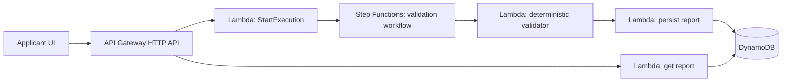

# SubmitReady — Ship It architecture

## Why each AWS component exists

- **API Gateway**: public application/report API.
- **Lambda**: small stateless handlers; the business rules stay testable locally.
- **Step Functions**: makes the validation pipeline explicit and recoverable as document checks grow.
- **DynamoDB**: stores the application ID, report status, check results and timestamps.
- **Cedar**: stores scheme/policy rules separately from application code. The current fixture is synthetic for the hackathon.
- **Textract (next adapter)**: extracts fields from uploaded documents in the Ship It version.

The important architectural boundary is that the validator never asks an LLM whether an application is eligible. Machine-checkable rules produce the decision; an optional explanation layer may explain the result.
