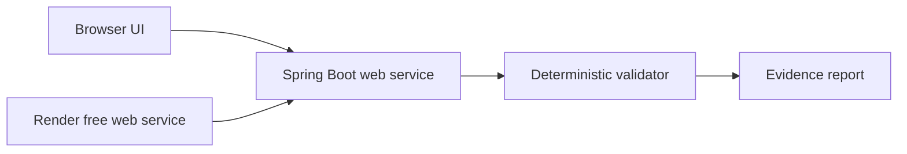

# SubmitReady architecture

## Runtime

- Spring MVC serves the static UI and JSON API from one public HTTPS service.
- The validator checks required fields/documents, evidence consistency, certificate validity, file constraints, and the synthetic domicile rule.
- Demo packets are packaged with the application. Validation requests are not persisted.
- Render builds the Docker image and uses `/api/health` for health checks.

The eligibility result is produced by deterministic rules, not by an LLM. The free-tier deployment is suitable for the synthetic demo only; real applicant data requires authentication, privacy controls, and durable storage.
